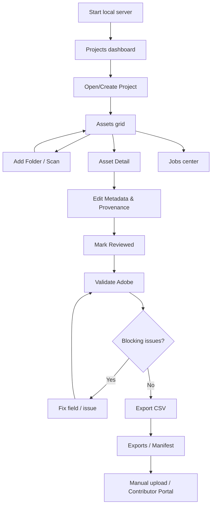
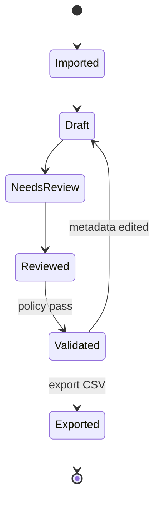

# AFD — Application Flow Design

**Acronym chosen:** Application Flow Design (explicitly defined because the original transcript did not expand AFD).

## 1. Primary navigation

## 2. Page definitions

| Screen | Inputs | Actions | Primary empty/error state |
|---|---|---|---|
| S01 Projects | name, search | create/open/rename | no project → create CTA |
| S02 Asset Library | folder root, filter by type/status/dup | scan, inspect, bulk select | missing root / no files / access denied |
| S03 Asset Detail | metadata fields, rights, AI toggle, releases | save, mark reviewed, compare revisions | corrupt file → no preview but editable record |
| S04 Batch Review | multi-selection, metadata operations | bulk apply, clear fields, validate | no selection → disabled with guidance |
| S05 Validation | target marketplace, rules version | validate, view issue list and fixes | 0 eligible assets |
| S06 Export | reviewed selection, batch options | preview CSV, generate, inspect manifest | validation failures block export |
| S07 Job Center | type, status, date filters | refresh, retry, cancel, view events | no jobs yet |
| S08 Settings | allowed roots, AI config, detected optional tools | test provider, configure preferences | provider disabled is normal |
| S09 Distribution (later) | eligible SFTP profile | transfer, verify, open portal | missing SFTP entitlement or credentials |

## 3. Happy-path acceptance narrative

1. User launches binary and opens `http://127.0.0.1:8080`.
2. Creates `Project A`.
3. Adds local folder containing 20 JPEGs; confirms scan scope.
4. `ScanAssets` job runs; progress updates without blocking browser.
5. Grid shows thumbnails and duplicate warning for identical hashes.
6. User selects 20 files and enters title/keywords/category and AI provenance; for unknown-rights images, marks that information explicitly.
7. User reviews each item (bulk review requires explicit confirmation with visible selection).
8. User chooses Adobe; validator provides blocking errors and warnings.
9. User corrects invalid items; revalidation passes and records version/time.
10. Export creates UTF-8 CSV and manifest. User can inspect/export file path from UI.
11. User closes/reopens app; project, metadata, export history and job events remain.

## 4. Status model

**Asset internal workflow**: `imported` → `metadata_draft` → `needs_review` → `reviewed` → `validated_for_adobe` (derived from latest successful validation at metadata revision). `validated_for_adobe` becomes invalid when metadata or policy version changes; do not persist as unquestioned truth.

**Job status**: `queued` → `running` → `succeeded|failed|canceled|paused`; restart recovery `running` → `paused` with event, then retry after reconciliation.

**Distribution status later, per asset & marketplace**: `not_prepared` → `prepared` → `transfer_queued` → `transferred|transfer_failed`; separate portal state `not_verified|submitted|approved|rejected`. Submission is a *user-verified or official-source-verified event*, never automatic from transfer success.

## 5. Flow with failure paths

### Folder scan
- Root invalid/inaccessible → return `INVALID_ROOT`, do not persist root unless validated.
- File corrupt → insert asset record with `preview_error` if identifiable, continue job.
- Symlink escaping root → skip/log with security issue.
- Duplicate paths or unchanged hash → update `last_seen` and skip duplicate DB insert.
- Stopped halfway → partial results remain; retry idempotently.

### Metadata save
- Revision mismatch → 409, client displays both revisions and requires user to reload/merge.
- Validation schema failure → 422, field-specific message.
- Editing reviewed metadata → `needs_review`, re-run compliance rules.

### Export
- Zero eligible → 422 list blocking reason.
- Filename collisions → 422 with conflicting paths; do not silently overwrite or map wrong asset.
- Over row/byte limits → split into numbered batch files, all <= limits, manifest maps every asset.
- Disk full → stop atomic write, remove only uncommitted temp export, preserve prior exports.

### AI integration (MVP-B)
- Disabled/unavailable → fallback manual editor.
- Explicit confirmation before sending images to provider.
- Malformed/unsafe AI output → show as rejected draft with diagnostic, no automatic write.

### Upload (MVP-C)
- Entitlement absent → no SFTP action, provide manual portal workflow.
- Success SFTP → `transferred`; user still completes portal metadata/release/submit.
- Network timeout after file transfer → `verification_required`, not blindly retry duplicate upload.

## 6. Component-level interaction

- Left sidebar: Projects / Assets / Validate & Export / Jobs / Settings.
- Main grid: cards with preview, provenance icon label, reviewed state, issue count.
- Detail pane: structured tabs; inline validation beneath fields, actual keyword order editable with drag & drop and keyboard controls.
- Confirmation modal: target path/provider, number of assets, data sent, cancel/continue.
- Export results: file name, rows, bytes, rules version, timestamp, download/open-local-file action consistent with browser restrictions.

## 7. Accessibility & consistency

Loading progress and status messages need text not just spinner; keyboard navigation and focus traps on modals; reject dialogs preserve user input; instructions Indonesian and errors actionable. No autoplay external actions.
