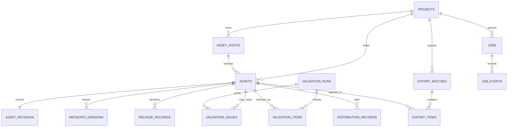

# DBD — Database Design Document

**Acronym chosen:** Database Design Document. DB engine SQLite, schema v1 for local single-user MVP.

## 1. Principles

- Assets are **references to source files**, not large BLOBs. Thumbnails/exports are stored on disk and mapped via opaque IDs.
- Metadata uses an editable current record **plus immutable revision history** for traceability.
- Keep **asset readiness** separate from **per-platform distribution** and **job status**.
- Jobs are durable across process restarts. No plaintext provider passwords/API keys in DB.
- Foreign keys enabled, atomic transactions for edits/exports, migrations tested against backup.
- IDs are UUID strings; timestamp fields `TEXT` UTC ISO-8601. `NULL` means unknown, not successful or negative.

## 2. Logical ER model



## 3. Proposed initial migration `0001_init.sql`

```sql
PRAGMA foreign_keys = ON;

CREATE TABLE schema_migrations (
  version INTEGER PRIMARY KEY,
  name TEXT NOT NULL,
  applied_at TEXT NOT NULL
);

CREATE TABLE projects (
  id TEXT PRIMARY KEY,
  name TEXT NOT NULL CHECK(length(trim(name)) BETWEEN 1 AND 120),
  created_at TEXT NOT NULL,
  updated_at TEXT NOT NULL
);

CREATE TABLE asset_roots (
  id TEXT PRIMARY KEY,
  project_id TEXT NOT NULL REFERENCES projects(id) ON DELETE RESTRICT,
  absolute_path TEXT NOT NULL,
  created_at TEXT NOT NULL,
  last_scan_at TEXT,
  UNIQUE(project_id, absolute_path)
);

CREATE TABLE assets (
  id TEXT PRIMARY KEY,
  project_id TEXT NOT NULL REFERENCES projects(id) ON DELETE RESTRICT,
  root_id TEXT NOT NULL REFERENCES asset_roots(id) ON DELETE RESTRICT,
  relative_path TEXT NOT NULL,
  display_filename TEXT NOT NULL,
  mime_type TEXT NOT NULL,
  file_size INTEGER NOT NULL CHECK(file_size >= 0),
  sha256 TEXT,
  width INTEGER,
  height INTEGER,
  duration_ms INTEGER,
  source_kind TEXT NOT NULL DEFAULT 'unknown'
    CHECK(source_kind IN ('unknown','human_photo','human_illustration','ai_generated')),
  rights_status TEXT NOT NULL DEFAULT 'unverified'
    CHECK(rights_status IN ('unverified','confirmed','restricted')),
  file_state TEXT NOT NULL DEFAULT 'present'
    CHECK(file_state IN ('present','missing','unreadable')),
  preview_error TEXT,
  last_seen_at TEXT NOT NULL,
  created_at TEXT NOT NULL,
  UNIQUE(root_id, relative_path)
);

CREATE TABLE asset_metadata (
  asset_id TEXT PRIMARY KEY REFERENCES assets(id) ON DELETE RESTRICT,
  revision INTEGER NOT NULL DEFAULT 1 CHECK(revision > 0),
  title TEXT NOT NULL DEFAULT '',
  description TEXT NOT NULL DEFAULT '',
  keywords_json TEXT NOT NULL DEFAULT '[]',
  category TEXT,
  language TEXT NOT NULL DEFAULT 'en',
  review_status TEXT NOT NULL DEFAULT 'needs_review'
    CHECK(review_status IN ('needs_review','reviewed')),
  reviewed_at TEXT,
  reviewed_revision INTEGER,
  updated_at TEXT NOT NULL
);

CREATE TABLE metadata_versions (
  id TEXT PRIMARY KEY,
  asset_id TEXT NOT NULL REFERENCES assets(id) ON DELETE RESTRICT,
  revision INTEGER NOT NULL,
  snapshot_json TEXT NOT NULL,
  change_reason TEXT NOT NULL,
  created_at TEXT NOT NULL,
  UNIQUE(asset_id, revision)
);

CREATE TABLE release_records (
  id TEXT PRIMARY KEY,
  asset_id TEXT NOT NULL REFERENCES assets(id) ON DELETE RESTRICT,
  release_type TEXT NOT NULL CHECK(release_type IN ('model','property')),
  reference_filename TEXT,
  verification_status TEXT NOT NULL DEFAULT 'unknown'
    CHECK(verification_status IN ('unknown','not_required','available','missing')),
  notes TEXT,
  updated_at TEXT NOT NULL
);

CREATE TABLE validation_runs (
  id TEXT PRIMARY KEY,
  project_id TEXT NOT NULL REFERENCES projects(id) ON DELETE RESTRICT,
  profile_id TEXT NOT NULL,
  rules_version TEXT NOT NULL,
  asset_selection_json TEXT NOT NULL,
  created_at TEXT NOT NULL
);

CREATE TABLE validation_items (
  id TEXT PRIMARY KEY,
  run_id TEXT NOT NULL REFERENCES validation_runs(id) ON DELETE RESTRICT,
  asset_id TEXT NOT NULL REFERENCES assets(id) ON DELETE RESTRICT,
  metadata_revision INTEGER NOT NULL,
  source_sha256 TEXT,
  passed INTEGER NOT NULL CHECK(passed IN (0,1)),
  checked_at TEXT NOT NULL,
  UNIQUE(run_id, asset_id)
);

CREATE TABLE validation_issues (
  id TEXT PRIMARY KEY,
  run_id TEXT NOT NULL REFERENCES validation_runs(id) ON DELETE RESTRICT,
  asset_id TEXT NOT NULL REFERENCES assets(id) ON DELETE RESTRICT,
  field_name TEXT NOT NULL,
  rule_code TEXT NOT NULL,
  severity TEXT NOT NULL CHECK(severity IN ('error','warning','info')),
  message TEXT NOT NULL,
  details_json TEXT NOT NULL DEFAULT '{}'
);

CREATE TABLE export_batches (
  id TEXT PRIMARY KEY,
  project_id TEXT NOT NULL REFERENCES projects(id) ON DELETE RESTRICT,
  profile_id TEXT NOT NULL,
  rules_version TEXT NOT NULL,
  export_dir TEXT NOT NULL,
  manifest_sha256 TEXT,
  file_count INTEGER NOT NULL DEFAULT 0,
  row_count INTEGER NOT NULL DEFAULT 0,
  total_bytes INTEGER NOT NULL DEFAULT 0,
  status TEXT NOT NULL CHECK(status IN ('building','ready','failed')),
  created_at TEXT NOT NULL
);

CREATE TABLE export_items (
  id TEXT PRIMARY KEY,
  export_batch_id TEXT NOT NULL REFERENCES export_batches(id) ON DELETE RESTRICT,
  asset_id TEXT NOT NULL REFERENCES assets(id) ON DELETE RESTRICT,
  source_metadata_revision INTEGER NOT NULL,
  csv_filename TEXT NOT NULL,
  row_index INTEGER NOT NULL,
  part_number INTEGER NOT NULL DEFAULT 1,
  UNIQUE(export_batch_id, asset_id)
);

CREATE TABLE jobs (
  id TEXT PRIMARY KEY,
  project_id TEXT REFERENCES projects(id) ON DELETE RESTRICT,
  type TEXT NOT NULL,
  status TEXT NOT NULL CHECK(status IN ('queued','running','paused','succeeded','failed','canceled')),
  idempotency_key TEXT UNIQUE,
  payload_json TEXT NOT NULL DEFAULT '{}',
  result_json TEXT,
  attempts INTEGER NOT NULL DEFAULT 0,
  max_attempts INTEGER NOT NULL DEFAULT 3,
  completed_items INTEGER NOT NULL DEFAULT 0,
  total_items INTEGER,
  error_code TEXT,
  created_at TEXT NOT NULL,
  started_at TEXT,
  finished_at TEXT,
  updated_at TEXT NOT NULL
);

CREATE TABLE job_events (
  id TEXT PRIMARY KEY,
  job_id TEXT NOT NULL REFERENCES jobs(id) ON DELETE RESTRICT,
  event_type TEXT NOT NULL,
  safe_message TEXT NOT NULL,
  metadata_json TEXT NOT NULL DEFAULT '{}',
  created_at TEXT NOT NULL
);

CREATE TABLE audit_events (
  id TEXT PRIMARY KEY,
  project_id TEXT REFERENCES projects(id) ON DELETE RESTRICT,
  asset_id TEXT REFERENCES assets(id) ON DELETE RESTRICT,
  event_type TEXT NOT NULL,
  safe_details_json TEXT NOT NULL DEFAULT '{}',
  created_at TEXT NOT NULL
);

CREATE TABLE distribution_records (
  id TEXT PRIMARY KEY,
  asset_id TEXT NOT NULL REFERENCES assets(id) ON DELETE RESTRICT,
  marketplace_id TEXT NOT NULL,
  transfer_status TEXT NOT NULL DEFAULT 'not_prepared'
    CHECK(transfer_status IN ('not_prepared','prepared','transfer_queued','transferred','transfer_failed','verification_required')),
  portal_status TEXT NOT NULL DEFAULT 'not_verified'
    CHECK(portal_status IN ('not_verified','submitted','approved','rejected')),
  receipt_reference TEXT,
  evidence_type TEXT,
  evidence_reference TEXT,
  updated_at TEXT NOT NULL,
  UNIQUE(asset_id, marketplace_id)
);

CREATE INDEX idx_assets_project_state ON assets(project_id, file_state);
CREATE INDEX idx_assets_sha256 ON assets(sha256);
CREATE INDEX idx_assets_source_kind ON assets(source_kind);
CREATE INDEX idx_metadata_review ON asset_metadata(review_status);
CREATE INDEX idx_jobs_status_created ON jobs(status, created_at);
CREATE INDEX idx_job_events_job_created ON job_events(job_id, created_at);
CREATE INDEX idx_validation_issues_run ON validation_issues(run_id);
CREATE INDEX idx_validation_items_asset_run ON validation_items(asset_id, run_id);
CREATE INDEX idx_exports_project_created ON export_batches(project_id, created_at);
```

Note: Data types, UNIQUE constraints, and migration statement behavior must be tested against the selected SQLite driver. SQL is the **contract to implement**, not a claim that migration has run. Schema may be split into `0001`, `0002` under documented ADR if needed.

## 4. Important relationships and derived values

- Duplicate group computed from `assets.sha256`; repeat scan upserts `(root_id,relative_path)` and updates attributes.
- Metadata current row is always generated on asset insert; `metadata_versions` stores immutable snapshot including title/keywords at each accepted change. Optimistic lock condition `WHERE revision = ?`.
- Validity is **derived** from newest `validation_items` and its parent `validation_runs` where `rules_version`, `metadata.revision` and source hash still match; old `validation_runs` remain audit history and are not authoritative after edits.
- Export stores `source_metadata_revision` so user can see whether exported snapshot differs from current metadata.
- `distribution_records` designed for later SFTP but not required to be populated in MVP-A.
- On source missing, preserve asset metadata and exports; do not cascade-delete.

## 5. Data lifecycle and privacy

- `projects` and asset metadata kept until explicit user deletion/cleanup in later feature; MVP implements no destructive delete UI.
- Source file path confined to local DB and internal service, sanitized in logs; frontend display may receive root-relative path.
- Thumb cache can be regenerated and cleaned. Exports remain until user explicitly removes.
- Backup: SQLite consistent backup API or shut down copy, not arbitrary copy of live WAL database. Migration backup first.
- Credentials **never** stored in DB in plaintext; config stores only provider metadata and credential reference names.

## 6. Migration and test requirements

- Start fresh creates full schema with FK enabled and known schema version.
- Running migrations twice does not duplicate work.
- Upgrade from prior version preserves data and created exports.
- Reopen existing DB after forced application kill.
- Test uniqueness collisions, revision conflict (409), orphan prevention, utf-8 keywords serialization, and job recovery.

## 7. Migration boundary to cloud

Replace SQLite repository adapter by a transactional hosted DB; keep IDs/DTOs. Replace absolute paths with object storage `asset_location` abstractions. Introduce `tenant_id`, auth and row-level authorization before multi-user access. Do not expose local filesystem paths in network-public routes.
