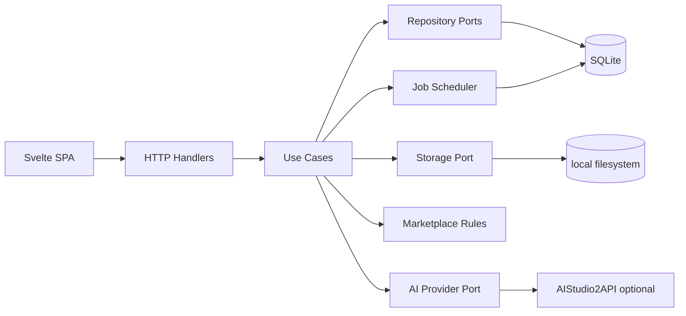

# TRD — Technical Requirements Document

## 1. Stack keputusan

| Layer | Choice | Alasan |
|---|---|---|
| HTTP backend | Go, pinned supported release | Portable, low idle resource, concurrency, testability |
| Router | net/http Go standard library unless proven otherwise | Minim dependency & toolchain |
| Frontend | Svelte + TypeScript + Vite | SPA statis, UI cepat, no SSR infrastructure |
| SQLite | pure-Go driver (evaluate `modernc.org/sqlite`) | No C compiler required for cross-platform releases |
| Storage | local filesystem under app data + allowed source roots | No cloud dependency |
| Migration | embedded SQL migrations, `schema_migrations` | Deterministic upgrades and rollback plan |
| Image reads | Go standard `image` packages + safe size/format detection | Avoid heavyweight runtime for MVP |
| AI integration | configurable OpenAI-compatible HTTP adapter | AIStudio2API optional |
| Media & metadata | ExifTool/FFmpeg as external, opt-in later | Keep core portable, declare dependency per feature |
| UI packaging | Go `embed` serving built Vite dist | One backend executable in release |

Agent harus pin exact versions di lockfiles *saat implementasi*, tidak diasumsikan oleh dokumen yang bisa lebih tua.

## 2. Logical components

Interfaces: `AssetRepository`, `MetadataRepository`, `JobRepository`, `Storage`, `PolicyValidator`, `CSVExporter`, `AIProvider`, `DistributionTransport`, `Clock`, `Hasher`. Handler layer tidak boleh langsung SQL, storage, atau invoke SFTP.

## 3. Configuration and startup

- Default `listen=127.0.0.1:8080`. Reject non-loopback bind without explicit `--unsafe-remote`/confirmed config and future auth implementation; jangan iklankan sebagai secure remote server.
- Default app data: OS user config/data dir (Windows `%LOCALAPPDATA%` or Linux XDG_DATA_HOME fallback); allow `--data-dir` for portability. No assumption about paths/case-separators.
- Config precedence: flags > environment > local config > defaults; no secret dump in diagnostics.
- Startup: validate config → create app dirs with restrictive permissions → acquire DB lock/SQLite pragmas → apply migrations → reconcile interrupted jobs → begin HTTP listener → health endpoint.
- Production binary serves prebuilt static files; dev mode Vite proxies API to Go.

## 4. Storage and import semantics

- `source roots` explicitly authorized by local user. Server only scans under normalized realpath; avoid unsafe symlink traversal. A root scan must ignore app data directory and common cache folders if nested.
- File import is **index by reference**, no copy required; record absolute canonical local path in DB server-side only; external API exposes `asset_id` and display path relative to permitted root.
- Read image headers with bounded memory; reject images exceeding configured pixel limit for decoding thumbs, with error reason.
- Calculate SHA-256 streaming and optional perceptual hash post-MVP; same SHA is exact duplicate, not similarity.
- Generated thumbnails derivatives in `data/cache/thumbs/{asset_id}/`; named by unique id not raw filename.
- Exports in `data/exports/{export_id}/` with atomic temp file → fsync/rename when supported. Create `manifest.json` and `.csv`.
- File mutation: originals never overwritten; derivative conversion creates separate file with provenance link.

## 5. Rules & metadata

- Metadata canonical model: title string, description string, keywords ordered string array, category per target profile, language, provenance, rights status, review state.
- Validation is pure function `Validate(asset, metadata, policyVersion) -> []Issue`; never invoke network.
- Adobe profile initial reference: CSV `Filename,Title,Keywords,Category,Releases` or exact official template after agent verifies. Current guidance: <=5000 rows, <=1MB, Title <=70 characters, Filename <=30 characters, Keywords <=50; treat **49 as preferred max** if content guideline differs from CSV spec. `Category` numeric and releases file names must correspond when required.
- Avoid global limits hardcoded into model. Keep platform-specific limits in `marketplace_rules` versioned JSON or Go definitions with source URLs and fixture tests. Block export when critical metadata is incomplete; warnings can be overridden with logged reason if policy allows.
- Serializing CSV must use RFC 4180 CSV writer, UTF-8, stable deterministic row sorting, formula injection protection for spreadsheet viewers (leading `=,+,-,@` handle as errors or safe replacement consistent with Adobe format), no ambiguous filename mapping.

## 6. Jobs & concurrency

- Persistent queue with status `queued/running/succeeded/failed/canceled/paused` and `attempts/max_attempts`; compare-and-swap claim update in transaction.
- MVP: 1–2 background workers, bounded concurrency and memory; no unbounded goroutines. Deadline per I/O and AI request.
- Job idempotency on `(type, scope_hash, relevant_revision)` and partial scan resume. On startup `running` → `paused` or `queued` with event, not falsely `succeeded`.
- Cancellation cooperative via context checks at checkpoints. Failure should not delete prior successful item results.
- Separate asset business status from job status. At-least-once execution may occur after a crash; side effects must be idempotent or require reconciliation, especially transfer.

## 7. API requirements

- Base `/api/v1`, JSON, consistent problem response `{error:{code,message,details,request_id}}`.
- Pagination & filters for assets; no bare server path access endpoints. Uniform UTC ISO-8601 timestamps.
- Methods GET list, POST actions/create, PATCH metadata, etc. Optimistic locking on metadata `revision` to prevent lost update (409 on conflict).
- Client-side routing fallback to index.html for non-API routes; correct CSP/X-Content-Type settings.
- Restrict CORS; local API only trusted origin, validate Host/Origin on mutations and use anti-CSRF defense. Auth later required for public hosting.
- Thumbnail endpoint stream file mapped via ID; prevent arbitrary file reads and directory traversal.
- Full contract: `specs/API_CONTRACT.md`.

## 8. Integration contracts

**AIProvider:** `Capabilities(ctx)`, `GenerateMetadataDraft(ctx, MediaSample, PromptSpec)`, `ListModels(ctx)` returns supported models or error. AIStudio2API: default base `http://127.0.0.1:2048/v1`, optional secret env reference. Offline or 401/429 returns `PROVIDER_UNAVAILABLE`/`RATE_LIMITED` status with retry; never alter reviewed metadata. UI discloses which images/frames are sent remotely.

**MediaProbe:** base image dimensional metadata uses Go, advanced FFmpeg/ExifTool adapter opt-in. Always check paths and invocation with argument arrays, not shell concatenation.

**DistributionTransport:** later `Prepare`, `Transfer`, `VerifyReceipt`; forbid `MarkSubmitted` as a consequence of `Transfer`. SFTP supported only with verified user credentials and authorized account; retry must avoid accidental duplicates and logs redact secrets.

## 9. NFR/SLO engineering targets (to validate, not guarantees)

- Initial local server health ready in <=5s on reference test setup without migrations; user laptop may differ.
- Typical 20 JPEG scan produces progress and completes within reasonable interactive session; no arbitrary hard SLA across storage hardware.
- Idle memory target **<200MB backend+frontend-serving process**, excluding dev tooling and optional AI/FFmpeg; measure and report actual numbers rather than assert compliance.
- No AI generation on user's CPU by default; 4GB RAM laptop compatible without installing heavyweight models.
- Accessible keyboard focus, empty/error states, no reliance on color alone.
- Code coverage: core validators/exporters and DB migrations prioritized; target >=80% of logic layer lines where feasible (not empty stubs).
- Build/test Windows amd64 and Linux amd64 in CI; document path limitations and any failed target.
- SQLite `foreign_keys=ON`, `journal_mode=WAL` where suitable, `busy_timeout`, backup before schema migrations.

## 10. Security and portability

- No secrets in frontend or API responses; provider creds in environment/OS credential store as optional; never SQLite plaintext secrets by default.
- Sanitize log values, mask URLs keys and credentials, and redact face/EXIF GPS from analytics; no analytics telemetry by default.
- Browser-local UI does not imply origin security; host allowlist + CSRF + loopback binding. Do not expose file browser to the network.
- Dependency scanning/license SBOM before releases; checksum built artifacts.
- Cloud requires redesign review for authentication, tenancy, object storage, secret management, worker durability & costs before deployment.

## 11. Deliverables per release

Go binary, frontend static bundle, migration files, `README` installation/run for Win/Linux, sample fixtures (not copyrighted media), example config without secrets, API documentation, tests and reports, exact versions with lockfiles, changelog, and policy version manifest.
