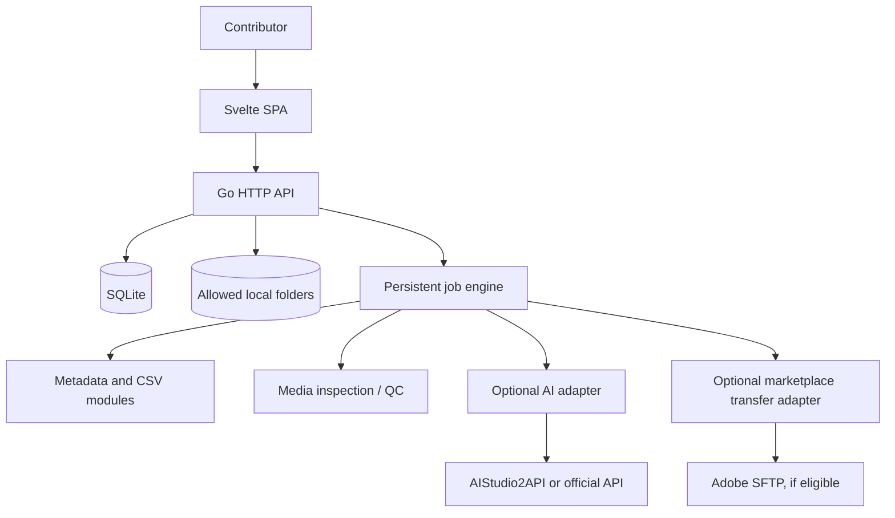

# SYSTEM.md — Microstock Automation Studio

**Version:** 1.0 · **Mode:** Local-first / Cloud-ready · **Owner role:** Individual contributor · **Status:** Proposed architecture

## Mission

Menyediakan workspace universal yang mengurangi pekerjaan berulang dalam produksi dan distribusi konten microstock secara akurat, aman, dan dapat diaudit. Manusia tetap mengendalikan hak konten, quality decisions, dan submission final bila platform tidak menyediakan jalur resmi untuk otomasi.

## Users & contexts

- **Primary:** kontributor microstock individu pada Windows/Linux dengan laptop spesifikasi rendah.
- **Secondary (later):** studio kecil, tim kontributor, dan AI agent yang mengakses workflow melalui API dengan izin yang dibatasi.
- **Initial usage:** satu pengguna, single-machine, tanpa autentikasi cloud, browser di localhost, file tetap berada di disk pengguna.

## System boundary

## Functional modules

1. Workspace & project management.
2. Asset index, metadata history, thumbnails, dedup.
3. Media type/provenance and release declarations.
4. Metadata edit, batch editing, AI suggestions with human review.
5. Quality checks and policy validation.
6. CSV export, manifest and audit trail.
7. Job queue/retry/cancel/resume and result logs.
8. Distribution adapters (post-MVP); AI generation (post-MVP); automation/agent (V2).

## MVP-A definition

- Create/open project, add scoped local folder, scan JPEG/PNG as **source files**; export profile Adobe JPEG. PNG boleh diimpor untuk review tetapi tidak langsung dinyatakan Adobe-ready tanpa transformasi memenuhi spesifikasi.
- Index file without mutating originals; calculate SHA-256, identify duplicate hashes, extract dimensions and generate small thumbnails.
- Single/bulk edit metadata title, keywords, category, description (internal), provenance (`human_photo`, `human_illustration`, `ai_generated`, `unknown`) and rights/release flags.
- Mark metadata as `reviewed` explicitly.
- Run deterministic Adobe CSV validator; generate CSV + manifest; show violations and repair instructions; handle 5,000-row/1MB splitting.
- Persist job and audit history across restart. UI works without AI provider and without market credentials.

## Hard invariants

- I1: **Source files remain immutable by default.** Exports and derivatives go into app-owned paths.
- I2: **No external asset transfer without an explicit user-initiated operation or approved policy.** AI vision sends media to external provider only after user action and disclosure.
- I3: **All outbound destination actions are gated** by provenance/rights/AI rules and platform capabilities.
- I4: **Separation of statuses:** asset readiness, transfer status, portal submission status, approval/rejection status are separate dimensions.
- I5: **No direct portal auto-submit for Adobe** as a default. Any future API must be documented from an official supported interface.
- I6: **Every job is identifiable, traceable, idempotent when retried**, and reports partial failure instead of silent success.
- I7: **No secrets in source, logs, CSV exports or frontend bundles**; source credentials stay local and redacted.
- I8: **AI output is untrusted draft**; it must satisfy schema, policy rules and human review prior to export.
- I9: **Cloud optionality** via interface boundaries: filesystem, database, queue, secrets, AI, marketplace.

## Non-goals now

Full autonomous content production, video transcode farms, commercial multi-user SaaS, unattended account login/scraping, CAPTCHA workarounds, sales scraping, direct payouts, AI model training, heavy local vision models, guaranteed sales/approval, real-time marketplace synchronization without APIs.

## Definition of system correctness

A batch can be imported → reviewed → validated → exported, without changing original content; every rejected item has an actionable reason; output CSV is deterministic and conforms to a pinned Adobe rule version; a restart preserves asset/job state; AI disabled cannot break core functionality.

## Source-of-truth hierarchy

1. Marketplace *official current policy* for platform compliance.
2. Approved `system.md` & ADRs for architecture and non-goals.
3. `PRD`, `TRD`, `AFD`, `DBD`, `BSD`, `API_CONTRACT`, `TEST_PLAN` for agreed behavior.
4. Repository references for implementation ideas only.
5. Agent assumptions only when written in a new ADR and test-verified.

## Future deployment path

A single Go backend serves API and static frontend. Replace local paths with object storage adapter and SQLite with managed database when cloud multi-tenancy requires it; use scheduled/background job service and signed URLs. Add auth/access control before exposing API to network. Appwrite/Render are options, **not required architecture dependencies**.
